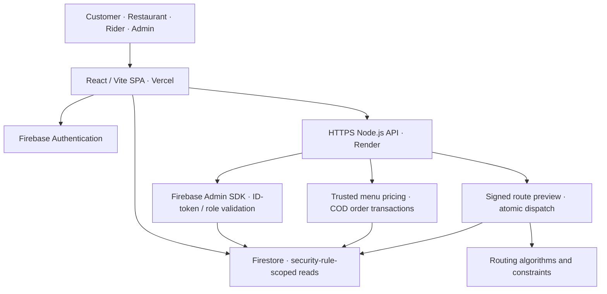

<div align="center">

# FOODROUTE 2.0

### Food ordering meets intelligent delivery-route optimization.

A modern, role-based **food-delivery and Design & Analysis of Algorithms (DAA) demonstration** built with React, TypeScript, Node.js and Firebase.

[**Live demo ↗**](https://foodroute-six.vercel.app/) · [**Hosted API health ↗**](https://foodroute-api.onrender.com/api/health) · [**Release notes**](docs/RELEASE_NOTES_v2.0.0.md) · [**Security**](SECURITY.md)


*Floating Food Experience — expressive food imagery, ivory surfaces, warm orange accents and responsive interfaces.*

</div>

> [!IMPORTANT]
> **Portfolio / academic demonstration, not a production food-delivery service.** The frontend and API are hosted, but deployment is **not a substitute for a full production security, payment, privacy and operational audit**. Use disposable accounts, sample addresses and simulated deliveries only. No real online payments, live GPS tracking or traffic-based arrival guarantees.

## What is FOODROUTE?

FOODROUTE 2.0 is a full-stack food-ordering prototype with separate customer, restaurant, rider and administrator experiences. It combines server-verified **cash-on-delivery (COD)** order quotations and transactional dispatch with a lab for studying route-optimization algorithms.

### Four dedicated dashboards

| Role | Implemented demonstration workflows | Route |
| :--- | :--- | :--- |
| **Customer** | Browse published restaurant menus, update a cart, get server-priced quotes, place COD test orders, review orders and personal insights | `/customer/dashboard` |
| **Restaurant** | Manage menu availability, configure a verified pickup/service area, progress authorized orders, view COD order-value reports | `/restaurant/dashboard` |
| **Rider** | Set availability, accept/decline assigned offers, progress sequential delivery steps, review assignment history | `/rider/dashboard` |
| **Admin** | Review applications, view operational insights, preview manual and optimized dispatch, commit supported assignments | `/admin/dashboard` |

The React route guard enhances UX; **security must be enforced by the backend, Firebase Authentication and Firestore rules**, not by the dashboard URL alone. Some onboarding approval functions and operational tools still require production-grade deployment/verification.

### DAA algorithm laboratory

| Algorithm | What it demonstrates | Complexity / limitation |
| :--- | :--- | :--- |
| **Greedy nearest neighbor** | Builds a tour from the current nearest stop | Typical `O(n²)` implementation; heuristic, not guaranteed optimal |
| **Held–Karp dynamic programming** | Exact TSP benchmark for small inputs | `O(n² · 2ⁿ)` time, `O(n · 2ⁿ)` memory |
| **2-opt** | Improves an existing route via local exchanges | Local search; performance depends on implementation and iterations |
| **Multi-rider insertion / improvement heuristic** | Allocates small stop batches with per-rider capacity | Demonstration of constrained allocation; **not** a full vehicle-routing solver |

The route sandbox uses illustrative coordinates, offline simulated estimates and optional consent-based development mapping. **The hosted API does not expose public road-demo or address-search endpoints.** No estimated route is a guaranteed ETA or road-safety recommendation.

## System architecture



**Core stack:** React 19, TypeScript, Vite 6, React Router 7, Node.js 22, Firebase Auth, Firestore, Firebase Admin SDK, Docker, Leaflet, Vitest, Playwright, Firestore Emulator Suite and GitHub Actions.

### Repository structure

```text
FOODROUTE/
├── apps/web/                 React frontend, dashboards, checkout and styles
├── services/functions/       Trusted backend, Firestore operations and Dockerfile
├── packages/routing-engine/  Route algorithms and algorithm tests
├── packages/contracts/       Shared contract scaffolding
├── firebase/                 Firestore rules and indexes
├── qa/browser/               Playwright browser smoke checks
├── scripts/                  Local development and release checks
├── tests/                    Release/integration test resources
├── docs/                     Implementation and security/deployment guides
└── .github/workflows/        GitHub Actions checks and manual release workflow
```

`services/ml-service/` and `services/optimizer-python/` are **future-development scaffolds**, not deployed services.

## Getting started locally

**Requirements:** Node.js 22 and npm, a Firebase development project or approved emulators, and Java 21 for Firestore emulator testing. Backend operations require an authorized development Firebase Admin identity.

```powershell
# From a clean checkout of this repository
git clone https://github.com/Animesh-666/FOODROUTE.git
cd FOODROUTE
npm ci

Copy-Item apps/web/.env.example apps/web/.env.local
```

Fill `apps/web/.env.local` with your own **public Firebase Web App configuration**, then set:

```ini
VITE_ORDER_API_MODE=local
VITE_USE_FIREBASE_EMULATORS=false
```

Run the development backend in one PowerShell terminal (using only authorized local credentials):

```powershell
$env:GOOGLE_CLOUD_PROJECT = "YOUR_DEVELOPMENT_FIREBASE_PROJECT_ID"
npm run dev:api --workspace services/functions
```

Run the React app in another terminal:

```powershell
npm run dev --workspace apps/web
```

Frontend: `http://localhost:5173` · Local API: `http://127.0.0.1:8787/api/health`.

For emulator setup, account-role provisioning and security rules, see [Firebase setup](docs/PHASE2_FIREBASE_SETUP.md) and the [Phase 7 runbook](docs/PHASE7_RELEASE_AND_DEPLOYMENT.md). **Never commit `.env.local`, Admin SDK JSON credentials, private OAuth secrets or signing keys.**

## Quality checks

Run from repository root after installing dependencies:

```powershell
node scripts/phase7-audit.cjs
node --test tests/phase7-release.test.cjs
npm run test:ci --workspace apps/web
npm run test:release --workspace services/functions
npm test --workspace packages/routing-engine
```

Firestore rules regression (requires Java and Firebase CLI):

```powershell
npx firebase-tools emulators:exec --config firebase.phase7.example.json --only firestore --project demo-foodroute-phase3 "npm --prefix apps/web run test:rules"
```

For browser smoke checks: `cd qa/browser`, `npm ci`, `npx playwright install chromium`, `npm test`. **Authenticated tests for all four roles require disposable staging accounts; skipped tests are not passing tests.** See [CI workflow](.github/workflows/foodroute-ci.yml) and [security disclosure](SECURITY.md).

## Hosted demo

| Service | URL / responsibility |
| :--- | :--- |
| **Vercel** | [foodroute-six.vercel.app](https://foodroute-six.vercel.app/) — frontend |
| **Render** | [foodroute-api.onrender.com/api/health](https://foodroute-api.onrender.com/api/health) — Node API health endpoint |
| **Firebase** | Auth and Firestore — project-specific configuration, not a public admin endpoint |

The frontend's Vercel environment contains **public web configuration** plus:

```ini
VITE_FIREBASE_API_KEY=YOUR_PUBLIC_WEB_API_KEY
VITE_FIREBASE_AUTH_DOMAIN=YOUR_FIREBASE_AUTH_DOMAIN
VITE_FIREBASE_PROJECT_ID=YOUR_FIREBASE_PROJECT_ID
VITE_FIREBASE_APP_ID=YOUR_PUBLIC_WEB_APP_ID
VITE_FIREBASE_STORAGE_BUCKET=YOUR_STORAGE_BUCKET
VITE_FIREBASE_MESSAGING_SENDER_ID=YOUR_SENDER_ID
VITE_USE_FIREBASE_EMULATORS=false
VITE_ORDER_API_MODE=cloudrun
VITE_ORDER_API_BASE_URL=https://foodroute-api.onrender.com
```

The `cloudrun` mode name is internal to this frontend API transport and also supports Render's compatible HTTPS API. Render separately requires an approved Firebase Admin identity, an exact `FOODROUTE_ALLOWED_ORIGINS` allowlist, and a stable private `FOODROUTE_PREVIEW_SIGNING_KEY` stored **server-side only**.

> [!NOTE]
> Render free instances may spin down when idle. The API root (`/`) intentionally returns `{"error":"Not found."}`; use `/api/health`. Health alone **does not prove Firebase authentication, checkout or dispatch**.

## Limitations and responsible use

- **COD prototype only:** order values are not payment-confirmed sales or audited revenue. No online payment gateway.
- **No live navigation:** no live rider GPS tracking, independently measured road ETA, or production traffic routing.
- **Approval and operational readiness:** admin/restaurant/rider onboarding and approval routines need production-grade deployment and review.
- **Additional security requirements:** distributed abuse mitigation, App Check or equivalent, credential rotation, observability, backup/restore, retention and privacy review remain release blockers for commercial use.
- **In-app activity only:** activity bell reflects authorized Firestore updates; not guaranteed persistent push delivery.
- **Assets and maps:** verify visual-asset licenses and external-provider terms before commercial use; never submit real customer pins to demo mapping services.

See [SECURITY.md](SECURITY.md) before disclosing vulnerabilities or testing any accounts other than your own.

## Documentation

- [v2.0.0 release notes](docs/RELEASE_NOTES_v2.0.0.md)
- [Phase 7 deployment and validation guide](docs/PHASE7_RELEASE_AND_DEPLOYMENT.md)
- [Phase 5D optimized dispatch](docs/PHASE5D_OPTIMIZED_DISPATCH_SETUP.md)
- [Road-routing algorithm sandbox](docs/PHASE5B_ROAD_ROUTING_SETUP.md)
- [Analytics and notifications](README_PHASE6B.md)
- [Firebase security/setup](docs/PHASE2_FIREBASE_SETUP.md)

---

<div align="center">

**FOODROUTE 2.0 — Learn. Build. Route smarter.**

[Live demo](https://foodroute-six.vercel.app/) · [Source](https://github.com/Animesh-666/FOODROUTE) · [Security](SECURITY.md)

</div>
