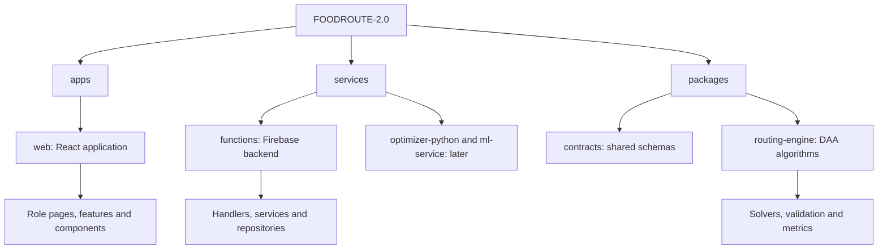

# FOODROUTE 2.0 — Folder flowchart

Status: all application modules are scaffold placeholders, not working implementations.

## Supporting directories at repository root

| Directory | Responsibility |
|---|---|
| firebase | Database/storage access rules and query indexes |
| tests | Cross-module rules, integration, browser tests and fixtures |
| scripts | Structure validation and planned development utilities |
| docs | Requirements, contracts, lifecycle, architecture and migration notes |
| .github/workflows | Future automation; no active deployment workflow |

## Frontend organization

`apps/web/src/features/` contains landing, auth, restaurants, cart, checkout, orders, tracking, profile, merchant, rider, admin, algorithm-lab, analytics and notifications. Shared layout, UI, maps and charts belong outside individual features. Merchant means the restaurant operator; restaurants is customer-facing discovery.

## Backend organization

`services/functions/src/` contains config, auth, restaurants, menu, cart, orders, dispatch, routing, rider, tracking, payments, notifications, analytics, admin, repositories and shared helpers.

Handlers validate and route requests to business services. Services enforce roles, ownership and state transitions. Repositories encapsulate Firestore access. Routing calculations import the independent routing-engine package. Contracts are shared by callers and handlers.

Open `OPEN_FOLDER_MAP.html` at the project root for an offline expandable explorer listing every packaged file and its purpose. See `FILE_STRUCTURE.md` for the complete tabular inventory.
