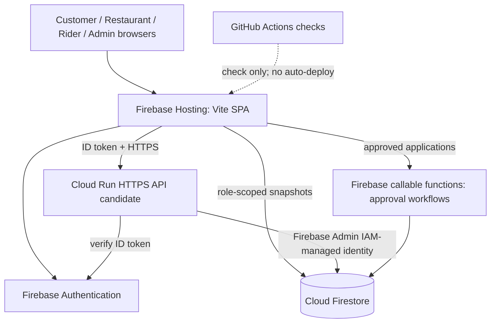

# FOODROUTE 2.0 — Release-candidate architecture

**Trust boundaries:** The SPA may display/hide UI but cannot grant roles, prices, payment success, or rider assignments. The backend checks verified Firebase Auth identity and Firestore profile data; Firestore Rules protect direct frontend reads/writes. Transactional order and dispatch changes happen on the trusted server. Firebase web config is public; Admin SDK identities and preview signing keys are private. Hosted API CORS is restricted by explicit origins but CORS alone cannot authorize operations.

**Environment paths:** Local development uses `127.0.0.1:8787` and a short-lived in-memory preview key. Cloud Run candidate uses `0.0.0.0:$PORT`, HTTPS frontend origins, workload identity, and a 32-byte stable secret from Secret Manager. The Spark plan does not provide Cloud Run, so public ordering needs an authorized billing decision or an alternate production-capable backend.

**Unsupported/disabled in hosted API candidate:** Public OSRM demonstration distance matrix and address search. Admin simulated road-lab features may present explicit unavailable errors in hosted mode until a contracted provider is integrated. Firebase notification bell is in-app and session-only, not delivery push. Rider GPS, traffic ETA and payment reconciliation are not included.

See `PHASE7_RELEASE_AND_DEPLOYMENT.md` for release blockers and tested behavior.
